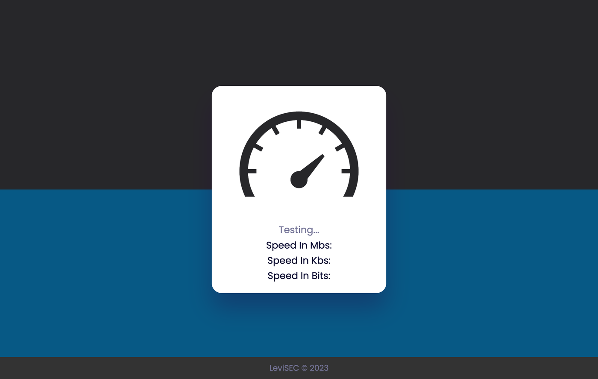

# Internet Speed Test

Estimates your download speed in the browser, in plain HTML, CSS and JavaScript.

The page downloads a random image, times how long it takes and divides the image's size by that time, then shows the result in bits, kilobits and megabits per second.

The images came from `source.unsplash.com`, which Unsplash has since shut down, so the test now stays on "Testing…". Pointing `imageApi` in `index.js` at any other large image with a known size makes it work again.

Open `index.html` in a browser to use it; there is nothing to install.
